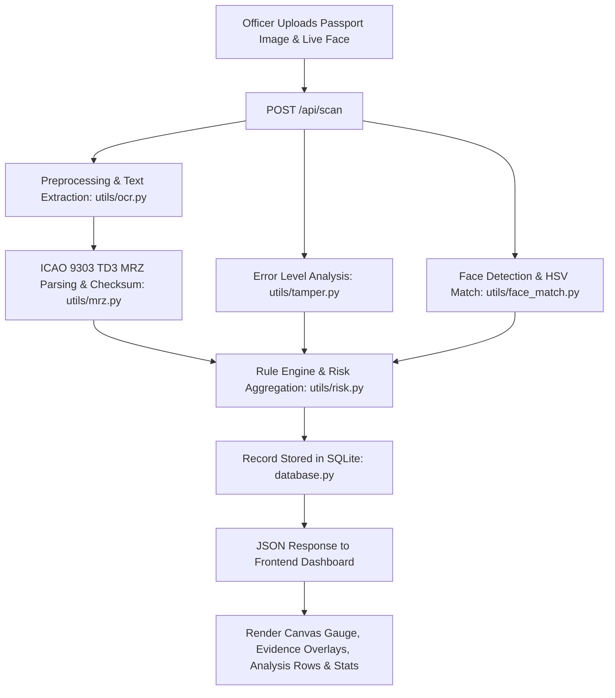

# Problem Statement & System Architecture

> **Note on Problem Statement (SH26188)**:
> Paste the exact official problem statement and guidelines directly from your SIH (Smart India Hackathon) portal login here. Below is the operational framing, core requirements, and technical panel-to-module mapping implemented in this codebase.

---

## 🎯 Problem Framing & Objective

Border control security personnel process thousands of international travelers daily under strict time constraints. Fraudulent documents (forged passports, tampered biographical data, spliced portrait photographs, expired credentials) present serious national security challenges.

### Core Challenges:
1. **Manual Inspection Bottlenecks**: Human visual inspection of micro-printing, checksums, and photo alterations is slow and error-prone.
2. **Multi-Vector Tampering**: Fraudsters alter textual fields, replace portrait photos, or fabricate entire MRZ zones.
3. **Decentralized Verification**: Need for a unified intelligence interface aggregating OCR, ICAO compliance checking, forensic image analysis, facial verification, and risk assessment into a single real-time dashboard.

---

## 🧩 UI Panel to Implementation Mapping

| UI Panel | Frontend Element | Backend Endpoint / Utility | Primary Function |
| :--- | :--- | :--- | :--- |
| **Topbar & Risk Counters** | `.stat-pill` (`#stat-total`, `#stat-high`, etc.) | `GET /api/stats` [`database.py`](backend/database.py#L70) | Displays real-time counts of scanned documents categorized by risk level. |
| **Document Upload & Live Photo** | `#preview-box`, `#file-input`, `#live-face-input` | `POST /api/scan` [`app.py`](backend/app.py#L39) | Ingests document image and optional webcam/live photograph for screening. |
| **Analysis Summary** | `#analysis-list` (`.analysis-row`, `.tag`) | `analysis` dictionary in `POST /api/scan` response | Reports status (VALID / ALERT / MATCH) across 6 forensic inspection dimensions. |
| **Extracted Information** | `#extracted-grid` | [`utils/mrz.py`](backend/utils/mrz.py#L22) [`utils/ocr.py`](backend/utils/ocr.py#L26) | Displays structured traveler fields (Name, Passport Number, Nationality, DOB, Sex, Expiry). |
| **Risk Score & Gauge** | `#gauge` (Canvas), `#gauge-score`, `#recommendation` | [`utils/risk.py`](backend/utils/risk.py#L6) | Computes 0–100 composite risk score with dynamic decision recommendation (Cleared / Secondary / Manual Review). |
| **Evidence & Suspicious Areas** | `#evidence-box`, `.marker` | [`utils/tamper.py`](backend/utils/tamper.py#L6) [`utils/face_match.py`](backend/utils/face_match.py#L14) | Overlays bounding boxes on suspected spliced regions and detected facial features. |
| **Recently Scanned Documents** | `#doc-table-body` | `GET /api/documents` [`database.py`](backend/database.py#L53) | Shows chronological audit trail of processed traveler records. |

---

## 🔄 Screening Pipeline Data Flow

